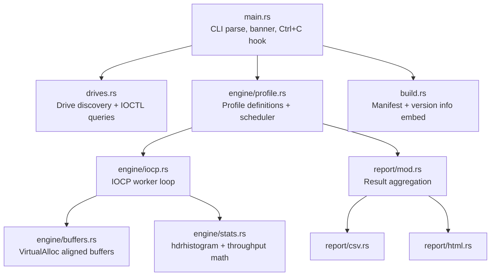

# dspd — Implementation Plan

## Goal

Build **dspd**: a single-binary, open-source Windows disk benchmark tool written in Rust, with a hand-rolled I/O engine using Windows I/O Completion Ports. It replicates CrystalDiskMark 9's four default test profiles and exports results as CSV and HTML reports.

---

## User Review Required

> [!IMPORTANT]
> **Build stages are sequential and gated on your approval.** Per the spec, we do Stage 1 (architecture proposal, this document) → Stage 2 (minimal scaffold + RND4K Q32T1 read only) → Stage 3 (full profiles + drive discovery + reports) → Stage 4 (release workflow). Each stage ends with testable instructions.

> [!WARNING]
> **`aarch64-pc-windows-msvc` cross-compilation** from an x64 Windows host requires `rustup target add aarch64-pc-windows-msvc`. The cross-linker is included in MSVC, but the target may not be installed yet. We'll add it in Stage 4.

> [!CAUTION]
> **SSD wear from write tests**: The tool writes a 1 GiB test file per drive. Every write test pass destroys about 1 GiB of flash P/E cycles. The CLI will warn the user and prompt for confirmation before any write test unless `--yes` is passed.

---

## Open Questions

> [!IMPORTANT]
> **Q1 — Desktop report path on multi-user machines?** The spec says "Timestamped reports on the Desktop". We'll use `$USERPROFILE\Desktop` via `SHGetKnownFolderPath(FOLDERID_Desktop)`. Is this acceptable, or do you want `--output-dir` to override that default (it's already in the CLI spec)?

> [!IMPORTANT]
> **Q2 — WMI fallback for drive info?** WMI adds `wmi` crate complexity. For Stage 2/3 the primary path is IOCTL; WMI fallback can be added as a follow-up. Acceptable?

> [!NOTE]
> **Q3 — `windows` vs `windows-sys`?** We'll use the high-level `windows` crate (idiomatic Result-returning wrappers) for IOCP and file I/O, and `windows` + `Win32_System_Ioctl` for storage IOCTLs. No `windows-sys` mixing unless compilation proves problematic.

---

## Architecture Overview



### Threading model

```
Main thread
  │
  ├─ writes test file (sequential, in-place, no IOCP needed)
  │
  └─ for each profile pass:
       spawn one Rust thread ("IOCP worker")
         │  owns: IOCP handle, file handle (OVERLAPPED)
         │  keeps N requests in-flight via GetQueuedCompletionStatusEx
         │  reissues immediately on each completion
         │  records per-I/O latency → hdrhistogram
         └─ joins back, returns PassResult { bytes, iops, histogram }
```

Sequential writes for file prep are done with plain `WriteFile` (no IOCP needed — throughput doesn't need to be measured, only correctness).

---

## Proposed Changes

### Stage 2 — Minimal scaffold + single profile

---

#### [NEW] `Cargo.toml`

```toml
[package]
name        = "dspd"
version     = "0.1.0"
edition     = "2021"
authors     = ["itznan"]
repository  = "https://github.com/itznan/dspd"
license     = "MIT"
description = "Fast, safe, single-binary disk benchmarking for Windows, written in Rust."
keywords    = ["benchmark", "disk", "io", "windows", "nvme"]
categories  = ["command-line-utilities"]
build       = "build.rs"

[[bin]]
name = "dspd"

[dependencies]
anyhow       = "1.0"
thiserror    = "2.0"
clap         = { version = "4.5", features = ["derive"] }
indicatif    = "0.18"
hdrhistogram = "7.5"
rand_xoshiro = "0.8.1"
rand_core    = "0.10"
chrono       = "0.4"
csv          = "1.3"
serde        = { version = "1.0", features = ["derive"] }

[target.'cfg(target_os = "windows")'.dependencies]
windows = { version = "0.58", features = [
    "Win32_Foundation",
    "Win32_Security",
    "Win32_Storage_FileSystem",
    "Win32_System_Com",
    "Win32_System_IO",
    "Win32_System_Ioctl",
    "Win32_System_Memory",
    "Win32_System_SystemInformation",
    "Win32_System_Threading",
    "Win32_UI_Shell",
] }

[build-dependencies]
winres = "0.1"

[profile.release]
opt-level      = 3
lto            = "fat"
codegen-units  = 1
panic          = "abort"
strip          = true

[profile.dev]
opt-level = 1   # enough for tolerable debug-mode I/O performance
```

---

#### [NEW] `build.rs`

Embeds the manifest (UAC `requireAdministrator`) and Windows VERSIONINFO resource.

```rust
// SPDX-License-Identifier: MIT
fn main() {
    if std::env::var("CARGO_CFG_TARGET_OS").as_deref() == Ok("windows") {
        let mut res = winres::WindowsResource::new();
        res.set_manifest_file("dspd.manifest");
        res.set("ProductName",      "dspd");
        res.set("FileDescription",  "dspd disk benchmark");
        res.set("CompanyName",      "itznan");
        res.set("LegalCopyright",   "Copyright (c) 2026 itznan");
        res.set("FileVersion",      env!("CARGO_PKG_VERSION"));
        res.set("ProductVersion",   env!("CARGO_PKG_VERSION"));
        res.compile().expect("winres compile failed");
    }
}
```

> [!NOTE]
> `env!("CARGO_PKG_VERSION")` is expanded at Cargo build time inside `build.rs` — this is a build-script constant, not a runtime env var.

---

#### [NEW] `dspd.manifest`

```xml
<?xml version="1.0" encoding="UTF-8" standalone="yes"?>
<assembly xmlns="urn:schemas-microsoft-com:asm.v1" manifestVersion="1.0">
  <trustInfo xmlns="urn:schemas-microsoft-com:asm.v3">
    <security>
      <requestedPrivileges>
        <requestedExecutionLevel level="requireAdministrator" uiAccess="false"/>
      </requestedPrivileges>
    </security>
  </trustInfo>
  <compatibility xmlns="urn:schemas-microsoft-com:compatibility.v1">
    <application>
      <!-- Windows 10 / 11 -->
      <supportedOS Id="{8e0f7a12-bfb3-4fe8-b9a5-48fd50a15a9a}"/>
    </application>
  </compatibility>
</assembly>
```

---

#### [NEW] `src/main.rs`

Entry point. Parses CLI, prints banner, wires Ctrl+C handler, dispatches to engine.

Key responsibilities:
- Print `dspd v<version> by itznan (github.com/itznan/dspd)`
- Parse `Args` via clap derive
- Register `ctrlc` handler that sets an `AtomicBool` and drops the cleanup guard
- Call `drives::discover()` → select target drives
- Call `engine::profile::run_all()` per drive
- Call `report::write_csv()` / `report::write_html()`

---

#### [NEW] `src/engine/mod.rs`

Re-exports `iocp`, `buffers`, `profile`, `stats`. Contains the public `RunResult` type.

---

#### [NEW] `src/engine/profile.rs`

Defines the four `Profile` structs and the `run_profile()` orchestrator.

```rust
pub struct Profile {
    pub name:       &'static str,    // e.g. "SEQ1M Q8T1"
    pub block_size: u64,             // bytes
    pub queue_depth: usize,
    pub threads:    usize,           // always 1 for now
    pub is_random:  bool,
}

pub const PROFILES: &[Profile] = &[
    Profile { name: "SEQ1M Q8T1",  block_size: 1 << 20, queue_depth: 8,  threads: 1, is_random: false },
    Profile { name: "SEQ1M Q1T1",  block_size: 1 << 20, queue_depth: 1,  threads: 1, is_random: false },
    Profile { name: "RND4K Q32T1", block_size: 4096,    queue_depth: 32, threads: 1, is_random: true  },
    Profile { name: "RND4K Q1T1",  block_size: 4096,    queue_depth: 1,  threads: 1, is_random: true  },
];
```

`run_profile()` calls `iocp::run_pass()` for each pass, discards the warmup interval, averages the results.

---

#### [NEW] `src/engine/iocp.rs`

The core unsafe I/O engine. This is where all Win32 calls live.

**OVERLAPPED pinning strategy:**

```rust
// Each in-flight request owns a heap-pinned OvlBox:
struct OvlBox {
    overlapped: Box<OVERLAPPED>,  // pinned on heap; raw ptr handed to kernel
    buf_index:  usize,            // which buffer slot this request owns
    offset:     u64,              // file offset for this request
}
```

`Box<OVERLAPPED>` keeps the struct at a stable heap address. We hand the raw pointer to `ReadFile`/`WriteFile` and recover it from `GetQueuedCompletionStatusEx`'s `lpOverlapped` field using `Box::from_raw` (only after the kernel returns it via GQCSE).

**Safety invariant (documented on each `unsafe` block):**
- The `Box<OVERLAPPED>` is _leaked_ (via `Box::into_raw`) before the syscall
- The kernel owns the memory until the completion appears on the IOCP
- We reconstitute the `Box` only from `lpOverlapped` after dequeue

**IOCP loop pseudocode:**

```
create IOCP → associate file handle → key = 1
issue min(queue_depth, total_ios) initial requests (each leaks its Box<OVERLAPPED>)

loop:
    GetQueuedCompletionStatusEx(iocp, entries, 16, &mut n, INFINITE, false)
    for each completed entry:
        recover Box<OVERLAPPED> via Box::from_raw(entry.lpOverlapped)
        record bytes transferred + latency
        if warmup period not elapsed: skip recording
        if more I/Os remain: issue next request (leak new Box<OVERLAPPED>)
        else: decrement in-flight counter
    if in_flight == 0: break
```

**Offset generation:**

```rust
// Sequential: offset = (request_index * block_size) % (file_size - block_size + 1)
// Random: offset = rng.next_u64() % num_blocks * block_size  (uniform over aligned blocks)
```

**Timing:** `QueryPerformanceCounter` polled at each I/O issue and completion for per-I/O latency. Pass-level timing is also QPC-based.

---

#### [NEW] `src/engine/buffers.rs`

```rust
pub struct AlignedBuffer {
    ptr:  *mut u8,
    size: usize,
}

impl AlignedBuffer {
    /// Allocates `size` bytes via VirtualAlloc with PAGE_READWRITE.
    /// Alignment is guaranteed to 65536 bytes (VirtualAlloc page granularity),
    /// which satisfies the 4096-byte sector alignment for FILE_FLAG_NO_BUFFERING.
    ///
    /// # Safety invariants
    /// - `ptr` is non-null and page-aligned
    /// - `size` must be a multiple of the logical sector size (512 or 4096)
    /// - The caller must not alias this buffer across threads without synchronization
    pub fn new(size: usize) -> anyhow::Result<Self> { ... }
}

impl Drop for AlignedBuffer {
    fn drop(&mut self) {
        // SAFETY: ptr was allocated by VirtualAlloc with MEM_RESERVE | MEM_COMMIT
        unsafe { VirtualFree(self.ptr as _, 0, MEM_RELEASE); }
    }
}
```

We allocate `queue_depth` buffers upfront, indexed by slot. Each in-flight OvlBox holds a `buf_index` pointing to its exclusive buffer slot.

**Buffer fill:** Each buffer is filled with `Xoshiro256PlusPlus` random data once at allocation time, then reused for all I/Os of that slot (read tests overwrite the buffer anyway).

---

#### [NEW] `src/engine/stats.rs`

```rust
pub struct PassResult {
    pub elapsed_ns: u64,
    pub bytes_xfer:  u64,
    pub iops:        u64,
    pub hist:        Histogram<u64>,   // latency in microseconds
}

impl PassResult {
    pub fn throughput_mb_s(&self) -> f64 {
        // MB/s = bytes / elapsed_ns * 1e9 / 1_000_000
        self.bytes_xfer as f64 / self.elapsed_ns as f64 * 1_000.0
    }
    pub fn avg_latency_us(&self) -> f64 { self.hist.mean() }
    pub fn p99_latency_us(&self) -> u64 { self.hist.value_at_quantile(0.99) }
}
```

Aggregation across passes: arithmetic mean of throughput, IOPS, avg latency; merge histograms for p99 (or take mean of pass p99s — plan is to merge).

---

#### [NEW] `src/drives.rs`

Drive enumeration and property queries.

```rust
pub struct DriveInfo {
    pub letter:     char,           // e.g. 'C'
    pub model:      String,
    pub bus_type:   BusType,        // NVMe | SATA | USB | Unknown
    pub media_type: MediaType,      // SSD | HDD | Unknown
    pub capacity:   u64,            // bytes
    pub free:       u64,            // bytes
}

pub enum BusType  { NVMe, SATA, USB, Unknown(u32) }
pub enum MediaType { SSD, HDD, Unknown }
```

Implementation path:
1. `GetLogicalDrives()` → iterate drive letters
2. `GetDriveTypeW()` → filter to `DRIVE_FIXED` (or include removable if `--include-removable`)
3. `GetDiskFreeSpaceExW()` → free/capacity
4. Open `\\.\X:` with `GENERIC_READ | FILE_SHARE_READ | FILE_SHARE_WRITE`
5. `DeviceIoControl(IOCTL_STORAGE_QUERY_PROPERTY, StorageDeviceProperty)` → `STORAGE_DEVICE_DESCRIPTOR` → model string + bus type
6. `DeviceIoControl(IOCTL_STORAGE_QUERY_PROPERTY, StorageDeviceSeekPenaltyProperty)` → `DEVICE_SEEK_PENALTY_DESCRIPTOR` → `IncursSeekPenalty` → HDD vs SSD
7. Skip drives where `free < test_size * 1.1`; print warning

---

#### [NEW] `src/report/mod.rs`, `csv.rs`, `html.rs`

`ReportRow` holds one profile × direction result. `csv.rs` uses the `csv` crate. `html.rs` produces a self-contained dark-themed HTML file (no external CDN dependencies — CSS is inline).

HTML layout mirrors CrystalDiskMark's table: columns are Read MB/s and Write MB/s per profile row, then an extended table with IOPS + latencies.

Footer: `Generated by dspd by itznan, github.com/itznan/dspd`

---

### Stage 3 — Full engine + drive discovery

Adds:
- All 4 profiles (only RND4K Q32T1 read in Stage 2)
- Read and write passes for each profile
- Drive discovery (`drives.rs`) wired into CLI
- Test-file lifecycle (`FileGuard` Drop impl that deletes the file; Ctrl+C handler)
- CSV + HTML report writing

---

### Stage 4 — CI and release workflow

---

#### [NEW] `.github/workflows/ci.yml`

```yaml
name: CI
on: [push, pull_request]
jobs:
  check:
    runs-on: windows-latest
    steps:
      - uses: actions/checkout@v4
      - uses: dtolnay/rust-toolchain@stable
        with: { components: "clippy, rustfmt" }
      - run: cargo fmt --check
      - run: cargo clippy -- -D warnings
      - run: cargo test
```

---

#### [NEW] `.github/workflows/release.yml`

```yaml
name: Release
on:
  push:
    tags: ["v*"]
jobs:
  build:
    strategy:
      matrix:
        target: [x86_64-pc-windows-msvc, aarch64-pc-windows-msvc]
    runs-on: windows-latest
    steps:
      - uses: actions/checkout@v4
      - uses: dtolnay/rust-toolchain@stable
        with: { targets: "${{ matrix.target }}" }
      - run: cargo build --release --target ${{ matrix.target }}
      - name: Package
        run: |
          $dir = "dspd-${{ matrix.target }}"
          New-Item -ItemType Directory $dir
          Copy-Item target/${{ matrix.target }}/release/dspd.exe, README.md, LICENSE $dir
          Compress-Archive -Path $dir -DestinationPath "$dir.zip"
          Get-FileHash "$dir.zip" -Algorithm SHA256 | Select-Object Hash | Out-File "$dir.zip.sha256"
      - uses: softprops/action-gh-release@v2
        with:
          files: "*.zip,*.sha256"
```

---

### File tree (all stages complete)

```
dspd/
├── .github/
│   └── workflows/
│       ├── ci.yml
│       └── release.yml
├── src/
│   ├── main.rs
│   ├── drives.rs
│   ├── engine/
│   │   ├── mod.rs
│   │   ├── iocp.rs       ← all Win32 unsafe I/O
│   │   ├── buffers.rs    ← VirtualAlloc aligned buffers
│   │   ├── profile.rs    ← 4 profiles + orchestrator
│   │   └── stats.rs      ← hdrhistogram + PassResult
│   └── report/
│       ├── mod.rs
│       ├── csv.rs
│       └── html.rs
├── tests/
│   ├── offset_alignment.rs
│   ├── histogram_stats.rs
│   ├── size_parse.rs
│   └── csv_output.rs
├── Cargo.toml
├── build.rs
├── dspd.manifest
├── LICENSE
├── README.md
└── CHANGELOG.md
```

---

## Dependency Table

| Crate | Version | Purpose |
|---|---|---|
| `windows` | 0.58 | Win32: CreateFile, IOCP, IOCTL, VirtualAlloc, QPC, Shell API |
| `clap` | 4.5 | CLI argument parsing (derive feature) |
| `anyhow` | 1.0 | Error propagation throughout |
| `thiserror` | 2.0 | Typed errors in engine and drives modules |
| `hdrhistogram` | 7.5 | Per-I/O latency histogram, p99 reporting |
| `rand_xoshiro` | 0.8.1 | Fast PRNG for random offsets and buffer fill |
| `rand_core` | 0.10 | SeedableRng / RngCore traits |
| `indicatif` | 0.18 | Live progress bars |
| `chrono` | 0.4 | Timestamp for report filenames |
| `csv` | 1.3 | CSV report serialization |
| `serde` | 1.0 | Derive for CSV row serialization |
| `winres` *(build)* | 0.1 | Manifest + VERSIONINFO embed |

---

## Validation guide (`--validate` output)

For each profile, dspd prints the equivalent DiskSpd command so users can cross-check numbers:

| dspd profile | DiskSpd equivalent |
|---|---|
| SEQ1M Q8T1 Read | `diskspd -b1M -d5 -W1 -t1 -o8 -r -Sh -w0 -L <file>` |
| SEQ1M Q8T1 Write | `diskspd -b1M -d5 -W1 -t1 -o8 -r -Sh -w100 -L <file>` |
| RND4K Q32T1 Read | `diskspd -b4K -d5 -W1 -t1 -o32 -r -Sh -w0 -L <file>` |
| RND4K Q32T1 Write | `diskspd -b4K -d5 -W1 -t1 -o32 -r -Sh -w100 -L <file>` |
| SEQ1M Q1T1 Read | `diskspd -b1M -d5 -W1 -t1 -o1 -r -Sh -w0 -L <file>` |
| SEQ1M Q1T1 Write | `diskspd -b1M -d5 -W1 -t1 -o1 -r -Sh -w100 -L <file>` |
| RND4K Q1T1 Read | `diskspd -b4K -d5 -W1 -t1 -o1 -r -Sh -w0 -L <file>` |
| RND4K Q1T1 Write | `diskspd -b4K -d5 -W1 -t1 -o1 -r -Sh -w100 -L <file>` |

> [!NOTE]
> `-Sh` disables software cache + hardware write cache (equivalent to `FILE_FLAG_NO_BUFFERING | FILE_FLAG_WRITE_THROUGH`). `-W1` is 1s warmup.

---

## Verification Plan

### Stage 2 automated tests

```powershell
# Must run as Administrator
cargo test                           # unit tests (no I/O required)
cargo clippy -- -D warnings
cargo fmt --check
cargo build                          # dev build compiles clean
```

### Stage 2 manual smoke test

```powershell
# Run from elevated PowerShell
cargo run -- --drives C --profile "RND4K Q32T1" --passes 1 --duration 5 --yes
```

**Expected output** (on a modern NVMe):
- `RND4K Q32T1 Read` should show roughly **100–3000 MB/s** depending on your NVMe
- Progress bar runs for ~6 seconds (1s warmup + 5s pass)
- No crash, no file left behind after exit

**Cross-check with DiskSpd:**
```
diskspd.exe -b4K -d5 -W1 -t1 -o32 -r -Sh -w0 -L C:\dspd_test.dat
```
Expect dspd's number to be within ±15% of DiskSpd on the same test file size (differences due to scheduling jitter and random-seed variance are normal).

### Stage 3 manual test — all profiles
```powershell
cargo run -- --drives C --passes 3 --yes
```
Check Desktop for `dspd_report_*.csv` and `dspd_report_*.html`. HTML should open in browser and show all 8 rows (4 profiles × Read/Write).

### Stage 4 CI test
Push a tag `v0.1.0`; confirm GitHub Actions builds two `.zip` files and attaches them to a GitHub Release.
